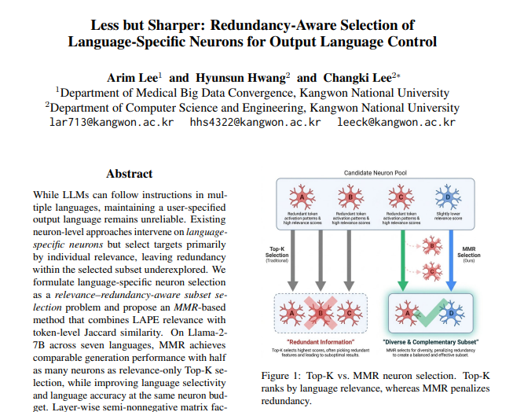

<h1 align="center">Less but Sharper</h1>

<p align="center">
  <strong>Redundancy-Aware Selection of Language-Specific Neurons<br>
  for Output Language Control</strong>
</p>

<p align="center">
  Arim Lee · Hyunsun Hwang · Changki Lee
</p>

<p align="center">
  
  
</p>

<p align="center">
  
</p>

Official reproduction package for **Findings of EACL 2027**.

The paper starts from LAPE language-specific neurons and asks a simple
question: can a smaller, less redundant subset control output language more
efficiently? This repository contains the data preparation, candidate
extraction, token-signature collection, Top-K/MMR/mRMR/k-DPP selection,
generation, evaluation, statistical testing, SNMF analysis, and released
artifacts used for the paper.

## Relationship to Language-Specific Neurons

The LAPE candidate-identification procedure and the mVicuna prompts originate
from [RUCAIBox/Language-Specific-Neurons](https://github.com/RUCAIBox/Language-Specific-Neurons).
We do not duplicate the upstream repository or prompt files here. Run:

```bash
bash scripts/fetch_upstream.sh
```

This checks out upstream commit `fdeca23` under
`external/Language-Specific-Neurons` and links its mVicuna prompts into
`data/mvicuna`. The scripts in `code/lape/` are architecture-generalized
wrappers retained to make the complete paper pipeline executable; please cite
the upstream project whenever using the LAPE stage.

## Repository layout

```text
Less_But_Sharper/
├── artifacts/                 # released masks, summary results, SNMF tables
├── code/
│   ├── analysis/              # SNMF and token-level causal notebooks
│   ├── data/                  # Wikipedia token preparation
│   ├── evaluation/            # PPL, generation, LID/judge, MMLU, statistics
│   ├── lape/                  # activation collection and LAPE candidates
│   └── selection/             # signatures, Top-K, MMR, mRMR, and k-DPP
├── docs/                      # detailed protocol and file provenance
├── scripts/                   # reproducible entry points
├── tests/                     # lightweight repository checks
└── requirements.txt
```

Large intermediate tensors, model checkpoints, Wikipedia token dumps, and raw
generation logs are intentionally excluded. They are regenerated under
`data/` and `work/`, both of which are ignored by Git.

## Installation

The original experiments used NVIDIA GPUs. A Python 3.10 environment is
recommended.

```bash
cd Less_But_Sharper
python -m venv .venv
source .venv/bin/activate
pip install -r requirements.txt
bash scripts/fetch_upstream.sh
```

Llama checkpoints are gated on Hugging Face; accept their licenses and run
`huggingface-cli login` before reproduction. For the historical PPL pipeline,
install the optional pinned vLLM environment separately:

```bash
pip install -r requirements-vllm.txt
```

## Quick start: use the released masks

The main paper setting is Llama-2-7B, `K=30`, MMR `lambda=0.6`, and steering
scale `1.3`.

```bash
python code/evaluation/generate_mvicuna.py \
  --model_tag llama2-7b \
  --activation_masks \
    artifacts/masks/llama2_topk_k30.pth \
    artifacts/masks/llama2_mmr_k30_lambda0.6.pth \
  --include_baseline \
  --mode steer --scale 1.3 \
  --data_dir data/mvicuna \
  --output_root work/generation
```

Download fastText's `lid.176.bin`, start an OpenAI-compatible local server for
the paper's Llama-3.1-70B judge, and score a generation directory:

```bash
python code/evaluation/score_generation.py \
  --input_dir work/generation \
  --output_root work/evaluation \
  --ft_model_path /path/to/lid.176.bin \
  --base_url http://localhost:8001/v1 \
  --judge_model llama-judge \
  --skip_existing
```

The paper used `RedHatAI/Meta-Llama-3.1-70B-Instruct-quantized.w4a16` as the
local judge. The server command depends on the serving framework and GPU
layout, so it is not hard-coded here.

## Full reproduction

The complete protocol is in [docs/REPRODUCIBILITY.md](docs/REPRODUCIBILITY.md).
At a high level:

1. Tokenize the 2023-11-01 Wikipedia snapshots for `en`, `zh`, `fr`, `es`,
   `vi`, `id`, and `ja`.
2. Collect activation rates and extract the bottom-1% LAPE candidate pool.
3. Record 30,000-token binary activation signatures for the candidates.
4. Select Top-K, MMR, mRMR, or k-DPP masks.
5. evaluate selective PPL ablation, mVicuna language steering, and MMLU.
6. run the SNMF redundancy and token-level causal analyses.

The two principal pipeline entry points are:

```bash
bash scripts/run_lape.sh
bash scripts/run_main_selection.sh
```

They accept environment overrides such as `MODEL_TAG`, `DATA_DIR`, `WORK_DIR`,
`K`, `LAMBDA`, and `DEVICE`; see the scripts for defaults.

## Paper configurations

| Setting | Value |
|---|---|
| Languages | en, zh, fr, es, vi, id, ja |
| Main backbone | Llama-2-7B |
| Additional backbones | OPT-6.7B, Mistral-7B-v0.2, Llama-3.1-8B (appendix) |
| LAPE candidate pool | bottom 1% entropy |
| Token signature length | 30,000 contiguous tokens per language |
| Main selection | K=30, MMR lambda=0.6 |
| Efficiency comparison | MMR K=20, lambda=0.7 vs. Top-K K=40 |
| Steering scale | 1.3 |
| SNMF | F=50, WTA=1%, max_iter=800, seed=0 |

Released masks for all reported main and cross-backbone settings are in
`artifacts/masks/`. Their SHA-256 checksums are recorded in
`artifacts/MANIFEST.sha256`.

Run the dependency-free repository checks with:

```bash
python -m unittest discover -s tests
```

## Reproducibility scope

This package was curated from experiment sources dated no later than
**2026-09-30**, matching the requested pre-October snapshot. Renaming and small
portability edits are documented in [docs/PROVENANCE.md](docs/PROVENANCE.md).
No post-cutoff training or experiment code is included.

## Citation

**Citation coming soon.** The ACL Anthology entry will be added after
publication.

## License and attribution

The original code in this repository is released under the [MIT License](LICENSE).
The upstream LAPE code and mVicuna data remain governed by their original
repository and upstream dependencies. Model and dataset licenses apply
separately.

## References

- 이아림, 황현선, 이창기. “LLM 출력 언어 제어를 위한 MMR 기반 언어 특화
  뉴런 집합 선택.” *한국정보과학회 2026 한국컴퓨터종합학술대회 논문집
  (KCC 2026)*, pp. 762–764, 2026. [Paper](https://www.dbpia.co.kr/journal/articleDetail?nodeId=NODE12929452)
